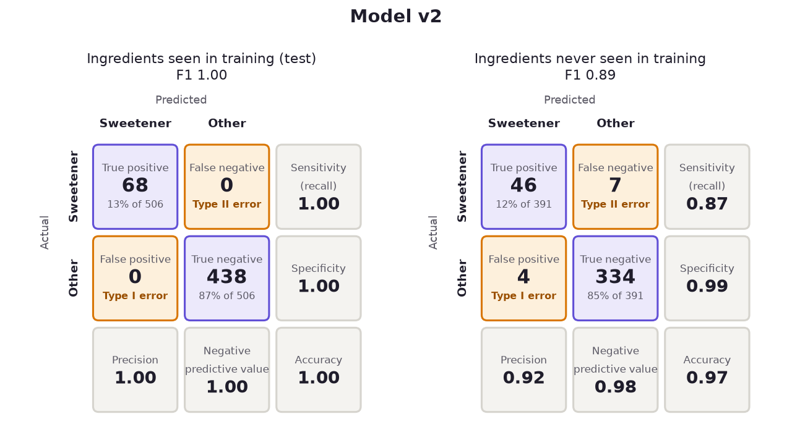

# The Sweet Truth Detector

Finds the sweeteners hiding in a packaged food's ingredient list, from typed text or a photo of the pack, and says why it flagged each one.

**[Try it live](https://bhawakshi-punia.github.io/sweet_truth/)** (phone or computer) · **[Case study](https://bhawakshi-punia.github.io/#projects/sweet-truth)**


## Why

From invert syrup to maltitol, sweeteners appear on labels under many unfamiliar names. This tool points out every ingredient that is a sweetener, natural or artificial.

## How it works

1. **Read:** a photo is read with Tesseract OCR; typed text is used as is.
2. **Split:** the list is split into single ingredients, keeping bracketed codes such as "(955)".
3. **Classify:** each ingredient is scored by **model v2**: TF-IDF over letter chunks of 1 to 6 characters, then logistic regression. Letter chunks let it recognise names it has never seen from parts like *-ose*, *-itol* or *syrup*, and show which parts made it say "sweetener".

## Results

On ingredients the model has **never seen**, v2 finds **87% of sweeteners** (precision 0.92). The original model (v1, whole words + random forest) found 38%. On the sample photos it finds all 5 printed sweeteners with no false flags, as v1 does. It is 0.2 MB in size.



v1's original "97% accuracy" was measured on lists whose ingredients all appeared in training, so it mostly measured memorisation. The full comparison (v1, v2 and a transformer experiment, on every set) is in [`reports/`](reports/README.md).

## Quick start

```bash
git clone https://github.com/bhawakshi-punia/sweet_truth.git && cd sweet_truth
uv sync --all-extras            # or, without uv: pip install -e ".[notebooks,train]"
uv run sweet-truth serve        # the web app at http://127.0.0.1:8000
```

From the command line:

```bash
uv run sweet-truth text "Glucose, Isomaltulose, Salt"
uv run sweet-truth image images/toothpaste.jpg
```

- **Photos** need [Tesseract OCR](https://github.com/tesseract-ocr/tesseract) (`brew install tesseract` / `apt install tesseract-ocr`).
- **Tests:** `uv run pytest`.
- **Live hosting:** the page is served by GitHub Pages and the detector runs on Render's free tier. After a quiet spell, the first check can take up to a minute while the detector wakes. Both redeploy on every push to `main`.

## Repository map

| Path | What is there |
| --- | --- |
| [`src/sweet_truth/`](src/sweet_truth/) | The detector: `text.py` (split, classify, explain), `ocr.py` and `image.py` (photos), `api.py` (web API), `cli.py` (the `sweet-truth` command) |
| [`src/sweet_truth/training/`](src/sweet_truth/training/README.md) | Training and evaluation, with [DATASET.md](src/sweet_truth/training/DATASET.md) and [APPROACH.md](src/sweet_truth/training/APPROACH.md) |
| [`reports/`](reports/README.md) | v1 vs v2 results, figures, and [how performance is judged](reports/EVALUATION.md) |
| [`notebooks/`](notebooks/) | Read in order: `01`–`03` build v1 (text classifier, OCR, full pipeline); `04`–`05` explore the data and evaluate v2 |
| [`data/`](data/README.md) | Labelled ingredients, synthetic lists and the test sets |
| [`models/`](models/) | `sweet_truth_v2.joblib` (app) and `sweet_truth_detector.pkl` (v1, used by the notebooks via `src/module_detector.py`) |
| [`web/`](web/) | The web page (plain HTML, CSS and JavaScript) |
| `Dockerfile`, `render.yaml`, `.github/` | Hosting: detector on Render, page on GitHub Pages |

## Limitations

- **Names with no clue in their spelling are missed:** thaumatin, cyclamate, neohesperidin. Next step: a curated list of sweeteners and their INS / E-numbers (950–969).
- **Look-alikes are flagged:** ethyl maltol, glucose oxidase.
- **Photos need to be clear and well lit.** Text printed after the ingredient list can be read as part of it.

Python · scikit-learn · spaCy · Tesseract OCR · OpenCV · FastAPI · Typer

## Licence and credits

- **Code:** [MIT](LICENSE).
- **Datasets in [`data/`](data/):** [CC BY 4.0](data/LICENSE). They were curated from the [FDA list of food ingredient types](https://www.fda.gov/food/food-additives-and-gras-ingredients-information-consumers/types-food-ingredients), the [Food Products Ingredient Dataset](https://data.mendeley.com/datasets/58mfpfxksk/1) (Kumar & Singh, 2024, CC BY 4.0) and articles on sweeteners.
- **Photos in `images/`:** taken by the author.
- **Ingredient text:** two typed ingredient lists in notebook 03 are quoted from [Open Food Facts](https://world.openfoodfacts.org/) product pages, which are linked there.
