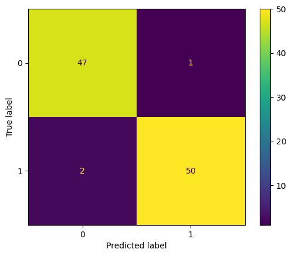
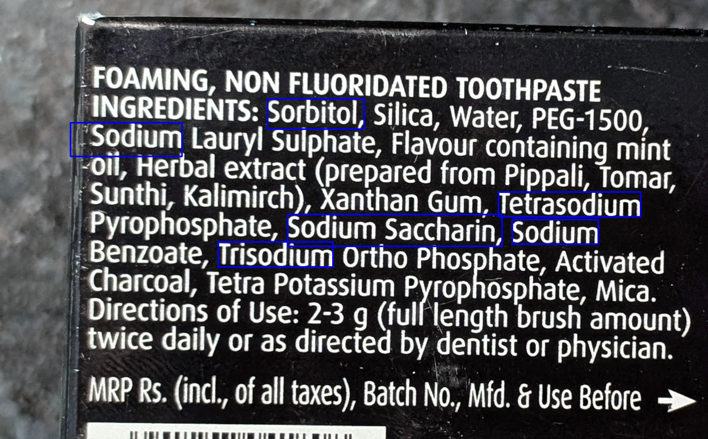

# The Sweet Truth Detector

A machine learning pipeline that detects hidden sweeteners in packaged food ingredient lists. It combines OCR, text preprocessing and a classifier to find and highlight sweeteners, from typed text or from a photo of the packaging.

**Case study:** [bhawakshi-punia.github.io/#projects/sweet-truth](https://bhawakshi-punia.github.io/#projects/sweet-truth)


## Why this project

From invert syrup to maltitol, sweeteners often appear on labels under unfamiliar names. This tool reads an ingredient list and points out every ingredient that is a sweetener, natural or artificial.

## How it works

The detector has two parts:

1. **Sweetener detection from text**: each ingredient is cleaned with spaCy and regular expressions, vectorised with TF-IDF and classified as sweetener or non-sweetener by a Random Forest classifier.
2. **OCR integration**: an image of the ingredient list is preprocessed with OpenCV, the text is extracted with Tesseract OCR and passed to the classifier, and detected sweeteners are marked on the image with bounding boxes.

## Data

- [`data/final_ingredient_dataset.csv`](data/final_ingredient_dataset.csv): 392 individual ingredients labelled as sweetener (1) or non-sweetener (0). Curated for commonly available Indian food products from the [FDA list of food ingredient types](https://www.fda.gov/food/food-additives-and-gras-ingredients-information-consumers/types-food-ingredients), a [Mendeley dataset](https://data.mendeley.com/datasets/58mfpfxksk/1/files/3f0a044f-0703-46a4-a59b-08e7ace09b3e) and articles listing common sweeteners.
- [`data/ingredients_sweeteners_list.csv`](data/ingredients_sweeteners_list.csv): 1,000 synthetic ingredient lists built from the dataset above, used to train and evaluate the classifier.

## Results

The tuned Random Forest classifier (`n_estimators=451`, `min_samples_split=6`) reaches **97% accuracy** on the hold-out set of 100 ingredient lists, with 0.97 precision, recall and F1.

| | |
| --- | --- |
|  |  |
| Hold-out set confusion matrix | A toothpaste label with detected sweeteners boxed |

## Getting started

```bash
git clone https://github.com/bhawakshi-punia/sweet_truth.git
cd sweet_truth
pip install -r requirements.txt
python -m spacy download en_core_web_sm
```

`pytesseract` also needs [Tesseract OCR](https://github.com/tesseract-ocr/tesseract) installed on your system (for example `brew install tesseract` on macOS).

## Usage

Run the following from the repository root.

### Step 1: Import the module and load the model

```python
import sys
sys.path.append("src")

from module_detector import *
import joblib

model = joblib.load("models/sweet_truth_detector.pkl")
```

### Step 2: Detect sweeteners from text

`sweet_truth_from_list(ingredient_list, model)` returns a dataframe of the detected sweeteners and the model's confidence in each.

```python
ingredient_list = "Glucose, Honey, Salt, Vitamins, Minerals"
sweet_truth_from_list(ingredient_list, model)
```

### Step 3: Detect sweeteners from an image

Give the path to a clear image of an ingredient list. Example images are in [`images/`](images/).

```python
image_path = "images/children_nutrition_drink.jpg"

# results as a dataframe
sweet_truth_from_image(image_path, model)

# annotate the image with bounding boxes around detected sweeteners
annotate_image_with_sweeteners(image_path, model)
```

The annotated image is saved next to the input, so `image.jpg` produces `image_annotated.jpg`.

## Repository layout

```
├── data/
│   ├── final_ingredient_dataset.csv        # individual ingredients, labelled
│   └── ingredients_sweeteners_list.csv     # synthetic ingredient lists for training
├── notebooks/
│   ├── sweetener_detector_from_text.ipynb  # Part 1: build and test the text classifier
│   ├── ocr.ipynb                           # Part 2: OCR on ingredient images
│   └── the_sweet_truth_detector.ipynb      # Parts 1 + 2: full pipeline, image to annotated output
├── src/
│   └── module_detector.py                  # preprocessing, classification, OCR and annotation functions
├── models/
│   └── sweet_truth_detector.pkl            # trained Random Forest pipeline
├── images/                                 # example inputs and annotated outputs
└── requirements.txt
```

The notebooks use paths relative to `notebooks/`, so run them from that folder. The model was saved with scikit-learn 1.5.2; loading it with another version may raise warnings.

## Limitations and next steps

- OCR sometimes over-annotates, for example boxing "Sodium" when the sweetener is part of a longer name such as "Trisodium".
- Results depend on a clear, well-lit photo of the ingredient list.
- Next: expand the sweetener alias list and deploy as a web app.

## Tech stack

Python · scikit-learn (Random Forest, TF-IDF) · spaCy · regular expressions · Tesseract OCR · OpenCV · Jupyter

## Image sources

The images used for testing in `the_sweet_truth_detector.ipynb` and `ocr.ipynb` are:

- **Self-captured**: images that I photographed for this project.
- **Open Food Facts**: openly available food ingredient images from [Open Food Facts](https://world.openfoodfacts.org/). These images are used solely for demonstration purposes and align with Open Food Facts' terms of use.
