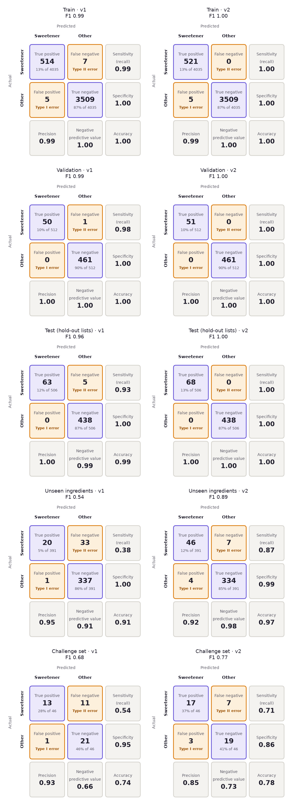

# Results: v1 vs v2

**v2** (letter chunks + logistic regression) replaced v1 (whole words + random forest) in the app. Both look near-perfect on the original test set, because its ingredients also appear in training. On ingredients never seen in training, **v2 finds 87% of sweeteners and v1 finds 38%**.

How the numbers are judged: [EVALUATION.md](EVALUATION.md). Data and method: [DATASET.md](../src/sweet_truth/training/DATASET.md), [APPROACH.md](../src/sweet_truth/training/APPROACH.md). Charts, mistakes and a try-it-yourself cell: [`notebooks/05_v2_evaluation.ipynb`](../notebooks/05_v2_evaluation.ipynb).



## Key measures

| Set | Model | Sensitivity | Precision | Specificity | F1 |
| --- | --- | --- | --- | --- | --- |
| Test (506 ingredients, all seen in training) | v1 | 0.93 | 1.00 | 1.00 | 0.96 |
| | **v2** | **1.00** | 1.00 | 1.00 | **1.00** |
| **Unseen ingredients** (391, 5-fold) | v1 | 0.38 | 0.95 | 1.00 | 0.54 |
| | **v2** | **0.87** | 0.92 | 0.99 | **0.89** |
| | ELECTRA-small (transformer experiment) | 0.70 | 0.84 | 0.98 | 0.76 |
| Challenge (46 real names) | v1 | 0.54 | 0.93 | 0.95 | 0.68 |
| | **v2** | **0.71** | 0.85 | 0.86 | **0.77** |

| | v1 | v2 | ELECTRA-small |
| --- | --- | --- | --- |
| Sample photos (3): found / missed / extra | 5 / 0 / 0 | 5 / 0 / 0 | 4 / 1 / 1 |
| Size | 7.2 MB | **0.2 MB** | 55 MB + PyTorch |

- **Every set, every measure:** `v1.json`, `v2.json`, `electra-small.json` and the evaluation notebook.
- **Per-model figures:** [unseen ingredients](figures/confusion_unseen.png) and [challenge set](figures/confusion_challenge.png), with ELECTRA-small included.

## Features or classifier?

Unseen-ingredient F1 for all four combinations, trained the same way (`ablation.json`):

| | Random forest | Logistic regression |
| --- | --- | --- |
| Whole words | 0.54 (v1) | 0.62 |
| Letter chunks | 0.69 | **0.89 (v2)** |

Both changes help; the letter chunks matter most.

## Regenerate

```bash
uv run sweet-truth model evaluate   # writes the JSON files and figures here
```
