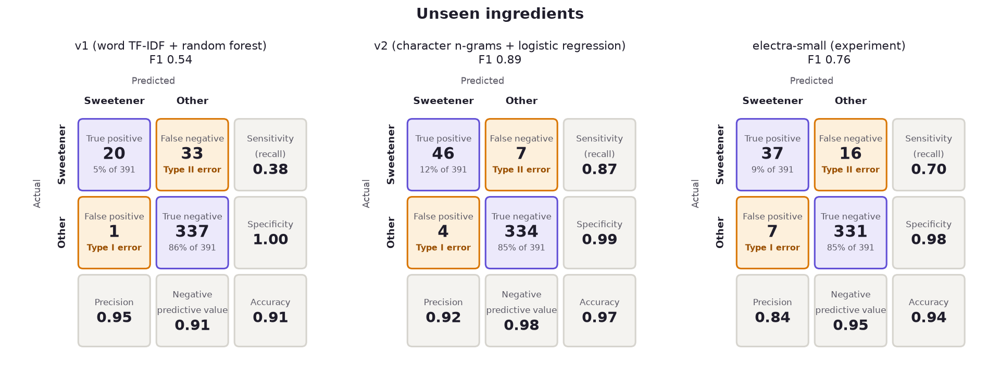
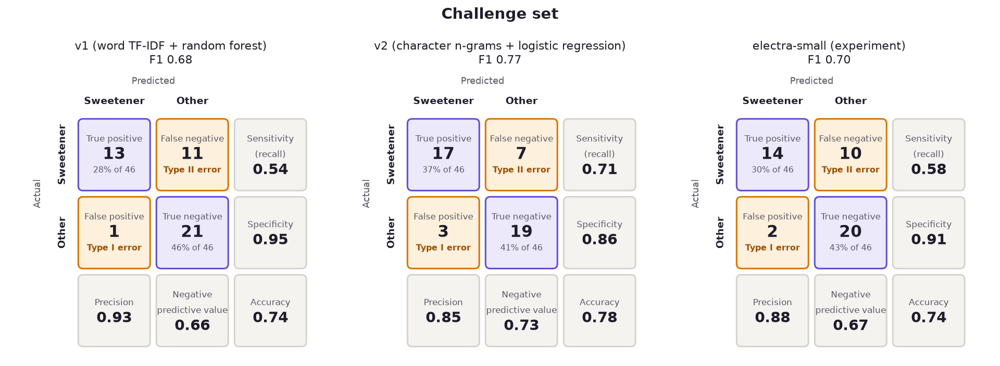

# Model comparison: v1 vs v2

**v2**, letter chunks + logistic regression, replaces v1 in the app. On the original test set every model scores near-perfectly, because all test ingredients were seen in training. On ingredients a model has never seen, v1 finds 38% of sweeteners and v2 finds 87%, with few false alarms. v2 is also 36 times smaller and can explain each prediction.

- How the numbers are judged: [EVALUATION.md](EVALUATION.md)
- The data and splits: [DATASET.md](../../src/sweet_truth/training/DATASET.md)
- The two models: [APPROACH.md](../../src/sweet_truth/training/APPROACH.md)
- Every number: [summary.md](summary.md) and the JSON files here (`v1.json`, `v2.json`, `electra-small.json`, `ablation.json`), written by `uv run sweet-truth model evaluate`
- Charts, mistakes and a try-it-yourself cell: [`notebooks/model_v2_evaluation.ipynb`](../../notebooks/model_v2_evaluation.ipynb)

## Confusion matrices

v1 vs v2 on every set (sweeteners are the positive class; violet = correct, amber = error):

The two sets that separate the models, with the ELECTRA-small transformer experiment alongside:

Per-set figures: [train](figures/confusion_train.png), [validation](figures/confusion_validation.png), [test](figures/confusion_test.png), [unseen](figures/confusion_unseen.png), [challenge](figures/confusion_challenge.png).

## Measures per set

Sensitivity (recall), specificity, precision, negative predictive value (NPV), accuracy and F1:

| Set | Model | Sensitivity | Specificity | Precision | NPV | Accuracy | F1 |
| --- | --- | --- | --- | --- | --- | --- | --- |
| Train (4,035) | v1 | 0.99 | 1.00 | 0.99 | 1.00 | 1.00 | 0.99 |
| | **v2** | 1.00 | 1.00 | 0.99 | 1.00 | 1.00 | 1.00 |
| Validation (512) | v1 | 0.98 | 1.00 | 1.00 | 1.00 | 1.00 | 0.99 |
| | **v2** | 1.00 | 1.00 | 1.00 | 1.00 | 1.00 | 1.00 |
| Test (506) | v1 | 0.93 | 1.00 | 1.00 | 0.99 | 0.99 | 0.96 |
| | **v2** | 1.00 | 1.00 | 1.00 | 1.00 | 1.00 | 1.00 |
| **Unseen (391)** | v1 | 0.38 | 1.00 | 0.95 | 0.91 | 0.91 | 0.54 |
| | **v2** | **0.87** | 0.99 | 0.92 | **0.98** | **0.97** | **0.89** |
| | ELECTRA-small | 0.70 | 0.98 | 0.84 | 0.95 | 0.94 | 0.76 |
| **Challenge (46)** | v1 | 0.54 | 0.95 | 0.93 | 0.66 | 0.74 | 0.68 |
| | **v2** | **0.71** | 0.86 | 0.85 | **0.73** | **0.78** | **0.77** |
| | ELECTRA-small | 0.58 | 0.91 | 0.88 | 0.67 | 0.74 | 0.70 |

| Also measured | v1 | v2 | ELECTRA-small |
| --- | --- | --- | --- |
| Test lists flagged correctly (original 97% measure) | 0.98 | 1.00 | 1.00 |
| Sample photos: sweeteners found / missed / extra flags | 10 / 0 / 1 | **10 / 0 / 0** | 9 / 1 / 1 |
| Size | 7.2 MB | **0.2 MB** | 55 MB + PyTorch |
| Time per ingredient | 5.5 ms | **0.02 ms** | 0.9 ms |

The few training false positives come from one label conflict in the original data ("Maltodextrin" is labelled a sweetener, "MALTODEXTRIN" is not).

## Features or classifier?

All four combinations, trained the same way on single ingredients (from `ablation.json`):

| Features | Classifier | Unseen P / R / F1 | Challenge accuracy |
| --- | --- | --- | --- |
| words | random forest (v1) | 0.95 / 0.38 / 0.54 | 0.74 |
| words | logistic regression | 0.93 / 0.47 / 0.62 | 0.74 |
| letter chunks | random forest | 0.94 / 0.55 / 0.69 | 0.83 |
| **letter chunks** | **logistic regression (v2)** | **0.92 / 0.87 / 0.89** | 0.78 |

Both changes help; the letter chunks matter most. See [APPROACH.md](../../src/sweet_truth/training/APPROACH.md) for the reasoning and the tuning caveat.

## What v2 still gets wrong

- **Missed, as by every model:** sweeteners with no telltale spelling, namely thaumatin, sodium cyclamate, neohesperidin dihydrochalcone, rebaudioside A, treacle and monk fruit extract.
- **Flagged wrongly:** look-alikes such as ethyl maltol and glucose oxidase.
- **Next steps:**
  - a curated list of sweeteners and their INS / E-numbers (950–969);
  - more labelled ingredient names.
